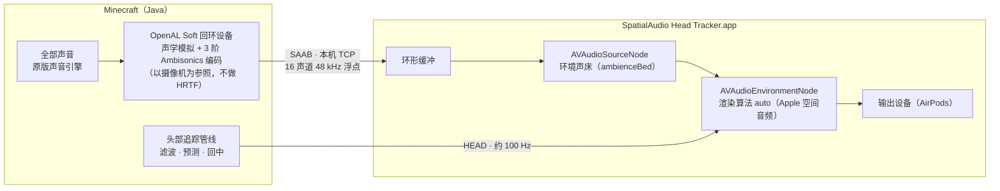
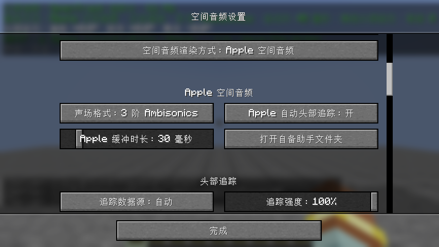

# Apple 空间音频渲染

除了模组内置的渲染器，SpatialAudio 还可以把“最后一步”——把声场渲染成耳机里的双耳声音、并随头部转动——交给 Apple 自己的空间音频完成。内置渲染器保持不变，三种方式在 **设置 → 通用 → 空间音频渲染方式** 中切换（也可执行 `/spatialaudio renderer <方式>`）：

| 渲染方式 | 谁完成双耳渲染 | 谁完成头部追踪 | 前后 / 高度 | 需要 |
| --- | --- | --- | --- | --- |
| **模组内置**（默认） | OpenAL Soft HRTF | 本模组（AirPods / OpenTrack） | ✅ / ✅ | 任意系统、任意耳机 |
| **Apple 空间音频** | Apple 空间音频引擎（`AVAudioEnvironmentNode`） | 本模组的头部姿态，交给 Apple 引擎旋转声场；具备授权的助手可改用 Apple 自动头部追踪 | ✅ / ✅（Ambisonics） | macOS 14+，推荐 Apple 芯片 |
| **Apple 系统空间化立体声** | macOS 系统“空间化立体声” | macOS（相对于 Mac） | ❌ / ❌（只有左右） | Apple 芯片、macOS 12.3+，需在 AirPods 菜单中手动打开 |

三种方式共用本模组的全部声学模拟：混响、遮挡、绕射、回声、空气吸收、水下 / 岩浆 / 细雪滤波与多普勒效应都在 OpenAL 中完成，最终都包含在交给 Apple 的声音里。

## Apple 空间音频

### 工作原理

1. 选择“Apple 空间音频”后，Minecraft 打开的不再是真实音频设备，而是 OpenAL Soft 的**回环设备**。OpenAL 照常处理每个声源的位置、衰减、混响与滤波，但不做 HRTF，而是把整个声场编码为 **Ambisonics**（ACN 顺序、SN3D 归一化，默认 3 阶 16 声道）——一种描述“各个方向传来多少声音”的球面声场格式，包含高度信息。
2. 声场**以游戏摄像机为参照**：鼠标转动视角时声场随之转动，但真实的头部转动不会作用到 OpenAL 上。
3. 模组通过本机 TCP（[SAAB 协议](SAAB-Protocol.md)，只监听 `127.0.0.1`，需要每次启动助手时随机生成的令牌）把声场实时交给 macOS 助手。助手以**拉取**方式工作：按音频硬件的消耗速度请求数据，模组的渲染时钟因此与 AirPods 的播放时钟同步，不会越积越多。
4. 助手把声场作为**环境声床**（`AVAudio3DMixingSourceMode.ambienceBed`）接入 `AVAudioEnvironmentNode`，渲染算法设为 `auto`。Apple 文档对环境声床的描述是：输入声道作为远场声源分布在听者周围，“锚定在全局空间”，渲染结果只取决于听者朝向。Apple 的引擎据此完成双耳渲染。
5. 头部转动时，助手旋转环境节点的**听者朝向**，声场因而固定在屏幕方向，与真实世界一致。头部姿态不经过音频缓冲，直接以约 100 Hz 发送，转头延迟与内置渲染器相当。

### 使用步骤

1. 确认 macOS 为 14 Sonoma 或更新；推荐 Apple 芯片的 Mac（Apple 的空间音频与个性化空间音频在 Mac 上要求 Apple 芯片）。
2. 在 **设置 → 通用 → 空间音频渲染方式** 中选择 **Apple 空间音频**，关闭设置界面。声音引擎会重新加载，助手随之启动并连接（状态面板显示“Apple 空间音频 · 正在渲染”）。
3. 游戏运行时点击菜单栏中的 AirPods 图标：如果其中为 **SpatialAudio Head Tracker** 列出了“空间音频 / 空间化立体声”，请设为 **关闭**。助手输出的已经是 Apple 渲染好的双耳声音，系统不应再处理一遍。Minecraft 本身此时不再直接发声，它的空间音频设置不起作用。
4. 正对屏幕按一次 `F6` 回中。

### 头部追踪的两种来源

| 来源 | 何时使用 | 说明 |
| --- | --- | --- |
| **本模组的头部姿态**（默认） | 随附的助手 | 头部姿态由本模组的管线处理（AirPods 或 OpenTrack，One Euro 滤波、延迟预测、回中、漂移校正），再交给 Apple 引擎旋转听者。`F6` 回中与头部追踪设置照常有效（头部平移除外） |
| **Apple 自动头部追踪** | 助手具备 `com.apple.developer.coremotion.head-pose` 授权，且 macOS 15+ | 开启“Apple 自动头部追踪”后，助手启用 `AVAudioEnvironmentNode.isListenerHeadTrackingEnabled`，由系统直接读取 AirPods 姿态；此时本模组的姿态不再作用，`F6` 无效 |

两者不会叠加：Apple 自动头部追踪生效时，助手忽略本模组发来的姿态。

### 个性化空间音频（个性化 HRTF）

Apple 文档说明：应用具备 `com.apple.developer.spatial-audio.profile-access` 授权（该授权自 macOS 15 起提供）时，系统会自动按用户在 iPhone 上建立的个性化空间音频档案调整 `AVAudioEngine` 的空间渲染。个性化空间音频本身需要 Apple 芯片的 Mac、macOS 13+，档案在 iPhone（iOS 16+，带原深感摄像头）上建立后经 iCloud 同步。

不具备该授权时，Apple 引擎使用通用的头部相关传递函数。Apple 空间音频正在渲染时，状态面板与 `/spatialaudio status` 的“渲染方式”一行会显示当前的头部追踪来源（“Apple 自动头部追踪”或“模组头部姿态”）；助手具备个性化空间音频授权时，还会显示“个性化空间音频”。

### 为什么随附的助手没有这两项授权

`head-pose` 与 `profile-access` 都是**受限授权**：Apple 只向付费的 Apple Developer Program / Developer ID 账号提供，并且必须由嵌入应用的描述文件（provisioning profile）批准。随附的助手在 GitHub Actions 中以 ad-hoc 方式签名，无法携带它们——带上未经批准的受限授权的程序会在启动时被系统直接终止。因此随附助手：

- 使用 Apple 的空间音频引擎与通用 HRTF 渲染；
- 由本模组提供头部姿态（只需要“运动与健身”权限，即 `NSMotionUsageDescription`）。

### 自备带授权的助手（可选）

拥有付费开发者账号的用户可以自行构建带授权的助手，解锁 Apple 自动头部追踪与个性化空间音频：

1. 在开发者网站为一个 App ID（例如 `com.example.spatialaudio.headtracker`）启用 **Head Pose** 与 **Spatial Audio Profile** 能力，生成 Developer ID 描述文件；
2. 用本仓库的 `native/macos/SpatialAudioHeadTracker/main.swift` 与 `Info.plist`（把 `CFBundleIdentifier` 改成你的 App ID）编译出 `SpatialAudioHeadTracker.app`；
3. 把描述文件复制为 `Contents/embedded.provisionprofile`，用包含两项授权（以及 `com.apple.application-identifier`、`com.apple.developer.team-identifier`）的 entitlements 文件和你的 Developer ID 证书签名；
4. 把整个 `.app` 放到 `.minecraft/config/spatialaudio/helper/custom/`（设置界面中有“打开自备助手文件夹”按钮）。

模组发现 `custom/SpatialAudioHeadTracker.app` 时会原样启动它，不会解压覆盖、也不会重新签名。

### 声场格式

| 格式 | 声道 | 说明 |
| --- | --- | --- |
| **3 阶 Ambisonics**（默认） | 16 | 方向最精确，包含高度。Apple 支持的最高阶数（WWDC19：多声道空间化支持“最高 3 阶的高阶 Ambisonics”） |
| 2 阶 Ambisonics | 9 | 数据量较小 |
| 1 阶 Ambisonics | 4 | 方向较模糊 |
| 7.1 | 8 | 仅水平面。OpenAL Soft 的 7.1 输出不使用中置与低音声道，高度信息会丢失，一般不推荐 |

格式修改后会重新加载声音引擎。

### 延迟

| 环节 | 典型值 |
| --- | --- |
| 助手缓冲（“Apple 缓冲时长”） | 30 ms（可调 10～200 ms） |
| Apple 引擎与音频设备输出延迟 | 由助手测得；状态面板“渲染方式”一行的“延迟约 … 毫秒”是助手缓冲与这一项之和 |
| 蓝牙传输（AirPods） | 约 150～250 ms，与渲染方式无关 |

头部姿态不经过音频缓冲，因此缓冲时长只影响“声音事件”的延迟，不影响转头的响应。听到断续声音时可适当增大缓冲。Apple 芯片的 Mac 在 macOS 14+ 全屏游戏时会启用“游戏模式”，Apple 说明它会把蓝牙采样率提高一倍，以降低 AirPods 的音频延迟。

### 自动回退

以下情况会自动改用模组内置渲染器，保证游戏始终有声音：

- 系统不满足要求（非 macOS 或低于 macOS 14）：状态显示“Apple 空间音频不可用（系统不支持）”；
- 无法创建本机音频桥，或 OpenAL 无法创建回环设备、不支持所选声场格式、无法在回环设备上创建上下文；
- 助手无法启动，或声场开始推送（或与助手断开）后 12 秒内没有连上（首次解压或编译助手的时间不计入）；
- 助手报告 Apple 渲染引擎持续出错超过 5 秒。

除第一种情况外，状态面板都会显示“已回退到模组内置渲染”并附上原因，各原因见 [回退原因](Troubleshooting.md#回退原因)。

排除问题后，点击设置界面中的“重启追踪与渲染”、重新选择渲染方式、修改声场格式或执行 `/spatialaudio restart` 即可再次尝试。

## Apple 系统空间化立体声（兼容模式）

这种方式完全使用 macOS 自带的功能，本模组只输出普通立体声：

- 关闭 OpenAL HRTF，以普通声像（`ALC_STEREO_BASIC_SOFT`）输出立体声；
- 不再旋转 OpenAL 听者，并停止本模组的头部追踪（由 macOS 负责）；
- 不需要助手。

**设置方法**（依据 Apple 的 AirPods 与 Beats 使用手册）：

1. Minecraft 播放声音时，点击菜单栏中的 AirPods（或 Beats）图标。若菜单栏中没有该图标，打开 **系统设置 → 菜单栏**，在“菜单栏控制”中选择“声音”；
2. 在“空间音频”（非杜比全景声内容显示为 **空间化立体声**）中选择 **头部追踪**（或“固定”）。这个设置按应用保存；
3. 确认 **系统设置 → 辅助功能 → 音频 → “空间音频跟随头部移动”** 处于开启状态（默认开启）。

**限制**：两声道立体声只携带左右信息，游戏中的前后与上下方位都会丢失；Apple 也说明空间音频“并非适用于所有 App 或内容”，本模组无法检测或替你打开这个设置。它适合想直接体验系统空间化效果的用户，追求定位准确请使用另外两种方式。

## 常见问题

| 现象 | 处理 |
| --- | --- |
| 状态一直是“Apple 空间音频 · 等待助手连接” | 查看头部追踪状态与日志中的助手错误；助手首次需要解压或编译，最长约 1 分钟 |
| 声音断断续续 | 增大“Apple 缓冲时长”；查看状态面板中的断音次数 |
| 声场转动两倍 | 菜单栏 AirPods 菜单中把 SpatialAudio Head Tracker 的空间音频设为“关闭”（若列出） |
| 想用 OpenTrack 追踪器 | 随附的助手无需设置，Apple 引擎会使用经本模组处理的 OpenTrack 姿态；使用带授权的自备助手时，关闭“Apple 自动头部追踪” |
| 转头没有反应 | Apple 自动头部追踪生效时本模组的设置不起作用；否则按 [头部追踪排障](Troubleshooting.md) 检查 |

## 参考资料

- Apple：[在 Mac 上控制空间音频与头部追踪（AirPods 使用手册）](https://support.apple.com/guide/airpods/control-spatial-audio-and-head-tracking-dev00eb7e0a3/web)
- Apple：[控制空间音频与动态头部追踪（Beats 使用手册）](https://support.apple.com/guide/beats/control-spatial-audio-head-tracking-apple-dev7db73ea55/web)
- Apple：[个性化空间音频](https://support.apple.com/en-us/102596)
- Apple：[在 Mac 上使用游戏模式](https://support.apple.com/en-us/105118)
- Apple：[Mac 辅助功能“音频”设置](https://support.apple.com/guide/mac-help/change-audio-settings-for-accessibility-unac611/mac)
- Apple Developer：[AVAudioEnvironmentNode](https://developer.apple.com/documentation/avfaudio/avaudioenvironmentnode)、[AVAudio3DMixingSourceMode.ambienceBed](https://developer.apple.com/documentation/avfaudio/avaudio3dmixingsourcemode/ambiencebed)、[isListenerHeadTrackingEnabled](https://developer.apple.com/documentation/avfaudio/avaudioenvironmentnode/islistenerheadtrackingenabled)
- Apple Developer：[Head Pose 授权](https://developer.apple.com/documentation/bundleresources/entitlements/com.apple.developer.coremotion.head-pose)、[个性化空间音频](https://developer.apple.com/documentation/phase/personalizing-spatial-audio-in-your-app)、[从多声道音频流生成空间音频（示例代码）](https://developer.apple.com/documentation/audiotoolbox/generating-spatial-audio-from-a-multichannel-audio-stream)
- WWDC19 Session 510：[What's New in AVAudioEngine](https://developer.apple.com/videos/play/wwdc2019/510/)
