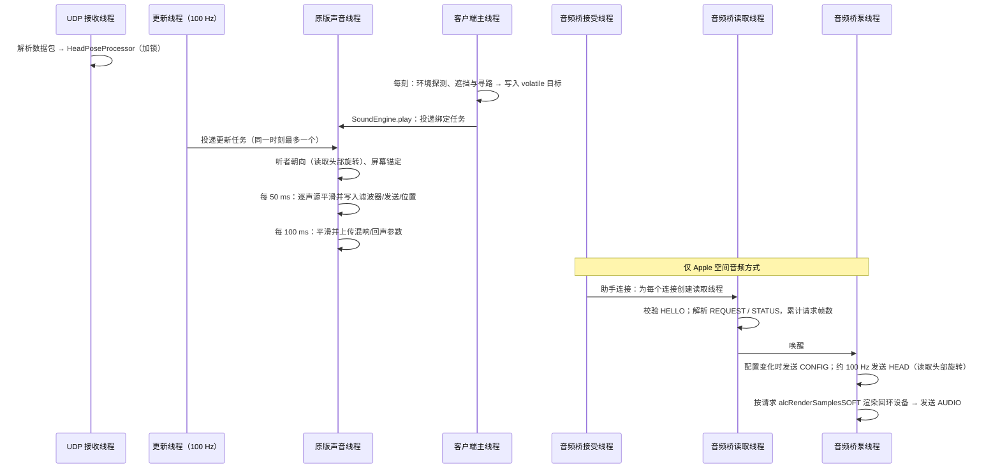

# 架构与源码导读

## 目录结构

```text
SpatialAudio/
├── build.gradle / gradle.properties     Gradle 构建（Fabric Loom 1.19，Java 25）
├── native/macos/                         macOS 助手（AirPods 头部追踪与 Apple 空间音频渲染）
│   ├── build.sh                          编译通用二进制、签名、自检、生成清单
│   └── SpatialAudioHeadTracker/
│       ├── main.swift                    读取 CoreMotion 并发送 SAHT 数据包；接收 SAAB 声场并交给 Apple 空间音频引擎
│       └── Info.plist                    含 NSMotionUsageDescription
├── src/main/java/io/github/obsidianplusplus/spatialaudio/
│   ├── SpatialAudio.java                 常量与日志
│   ├── config/                           配置数据、读写与校验
│   ├── math/                             四元数、One Euro 滤波
│   ├── headtracking/                     UDP 接收、协议解析、姿态处理、助手启动
│   ├── audio/                            OpenAL 接管：HRTF、EFX、听者、逐声源处理
│   ├── apple/                            Apple 空间音频渲染：回环设备、SAAB 音频桥、自动回退
│   ├── acoustics/                        声学模拟：材质、射线、探测、遮挡、寻路、混响模型
│   ├── client/                           入口、按键、命令、叠加层、设置界面、兼容
│   └── mixin/                            四个 Mixin 注入点
├── src/main/resources/                   fabric.mod.json、Mixin 配置、语言文件、图标
├── src/test/                             单元测试（JUnit 5）
├── src/gametest/                         客户端集成测试（Fabric Client GameTest）
└── wiki/                                 本文档
```

## 模块职责

| 包 | 主要类 | 职责 |
| --- | --- | --- |
| `config` | `SpatialAudioConfig`、`ConfigManager`、`CategorySettings`、`SpatialRenderer`、`AppleBedFormat` | 配置字段、默认值、合法性修正、JSON 读写与快照；渲染方式与 Apple 声场格式 |
| `math` | `Quat`、`OneEuroFilter` | 头部坐标系四元数运算；旋转版 1€ 滤波器 |
| `headtracking` | `HeadTrackingManager`、`HeadPoseProcessor`、`UdpPoseReceiver`、`SahtProtocol`、`OpenTrackProtocol`、`MacHelperLauncher` | 接收数据、滤波预测回中、生命周期、助手的解压/编译/签名/启动 |
| `audio` | `AudioSystem`、`ListenerController`、`SourceProcessor`、`EfxManager`、`SpatialSource`、`AudioUpdateThread` | OpenAL 上下文属性、扩展探测、EFX 资源、听者朝向合成、逐声源参数、周期更新 |
| `apple` | `AppleRenderer`、`AppleAudioBridge`、`AppleBridgeProtocol`、`AppleRendererStatus` | Apple 空间音频渲染方式：回环设备、SAAB 音频桥、回退与状态（见 [下文](#apple-空间音频apple-包)） |
| `acoustics` | `AcousticsManager`、`OcclusionSolver`、`AirPathFinder`、`EnvironmentProbe`、`ReverbModel`、`BlockAcoustics`、`VoxelRaycaster` | 世界查询、遮挡、绕射寻路、环境探测、混响映射 |
| `client` | `SpatialAudioClient`、`KeyBindings`、`SpatialAudioCommands`、`SpatialAudioHud`、`screen/*`、`compat/*` | 入口与用户界面 |
| `mixin` | 见下表 | 注入原版音频代码 |

`acoustics` 中的算法类（`OcclusionSolver`、`AirPathFinder`、`EnvironmentProbe`、`ReverbModel`、`VoxelRaycaster`）只依赖 `BlockQuery` 接口，不依赖 Minecraft，可以在单元测试中用合成世界验证。

## Apple 空间音频（`apple` 包）

选择“Apple 空间音频”渲染方式时，OpenAL 不再输出到真实设备，而是渲染到 OpenAL Soft 的**回环设备**；声场经本机 TCP（[SAAB 协议](SAAB-Protocol.md)）交给 macOS 助手，由 Apple 的空间音频引擎完成双耳渲染。面向玩家的说明见 [Apple 空间音频渲染](Apple-Spatial-Audio.md)。

| 类 | 职责 |
| --- | --- |
| `AppleRenderer` | 单例总协调者。主线程：按配置建立或关闭音频桥（`configure`），每刻检查回退条件（`tick`），为界面计算状态；声音引擎加载时：打开回环设备（`openLoopbackDevice`）、构建回环上下文属性、上下文就绪后把渲染源交给音频桥（`onContextReady`）、上下文销毁前停止渲染（`onLibraryCleanup`）；为助手提供启动参数（端口与令牌，每次启动助手都更换令牌） |
| `AppleAudioBridge` | SAAB 的模组端：在 `127.0.0.1` 的临时端口监听，校验令牌，管理接受、读取、泵三个线程以及请求额度与配置代次；发送 CONFIG、HEAD、AUDIO，接收 HELLO、REQUEST、STATUS |
| `AppleBridgeProtocol` | SAAB 常量与纯编解码函数，不涉及套接字，可直接单元测试 |
| `AppleRendererStatus` | 渲染方式的运行状态，设置界面、调试叠加层与命令共用；翻译键为 `spatialaudio.apple_status.*` 及其 `.hint` |

其它包中与渲染方式相关的部分：

| 位置 | 作用 |
| --- | --- |
| `AudioSystem.buildContextAttributes` | 回环设备使用 `AppleRenderer` 构建的属性（声场格式、关闭 HRTF、输出限幅、两个辅助发送）；“Apple 系统空间化立体声”关闭 HRTF 并请求 `ALC_STEREO_BASIC_SOFT` 普通立体声 |
| `AudioSystem.activeRenderer()` | 当前 OpenAL 上下文**实际**采用的渲染方式：选择了 Apple 空间音频但系统不支持或已回退时为内置渲染器 |
| `ListenerController` | 实际渲染方式不是内置渲染器时使用单位头部旋转，也不叠加头部平移：OpenAL 听者只跟随摄像机（`SpatialRenderer.rotatesOpenAlListener()`） |
| `HeadTrackingManager` | AirPods 追踪或 Apple 渲染任一需要时启动助手；“Apple 系统空间化立体声”方式下把数据源视为“关闭” |
| `MacHelperLauncher` | 为助手追加 `--audio-port` / `--audio-token`；不需要 AirPods 姿态时传 `--port 0`；存在 `config/spatialaudio/helper/custom/SpatialAudioHeadTracker.app` 时原样启动它（不解压、不重新签名） |

### 回退

`AppleRenderer` 在两处判断是否改用内置渲染器：

1. **打开设备时**（声音引擎加载线程）：检查 `ALC_SOFT_loopback`、Ambisonics 格式所需的 `ALC_SOFT_loopback_bformat` 与最高阶数、`alcIsRenderFormatSupportedSOFT`，再用即将使用的属性**试建一次上下文**。原版在上下文创建失败时会关闭整个声音系统，提前试建可以在失败时改为打开真实设备，保证游戏仍有声音。
2. **每个客户端刻**（主线程）：助手启动失败、声场开始推送（或与助手断开）后 12 秒内没有连上（解压或编译助手的时间不计入）、助手报告引擎出错持续 5 秒以上，都会记录原因并重新加载声音引擎，原版随之重新打开真实设备。

回退状态在重新选择渲染方式、修改声场格式、点击“重启追踪与渲染”或执行 `/spatialaudio restart` 时清除。各原因的含义与处理见 [常见问题与排障](Troubleshooting.md#回退原因)。

## Mixin 注入点

| Mixin | 目标 | 注入 | 作用 |
| --- | --- | --- | --- |
| `LibraryMixin` | `com.mojang.blaze3d.audio.Library` | `init` 中的 `openDeviceOrFallback`（WrapOperation） | Apple 空间音频方式下改为打开 OpenAL Soft 回环设备（`alcLoopbackOpenDeviceSOFT`）；未选择、已回退或回环设备不可用时照常打开真实设备 |
| | | `createAttributes` HEAD（可取消） | 替换上下文属性：HRTF、输出模式、辅助发送通道；回环设备改用声场格式属性 |
| | | `init` TAIL | 使用回环设备时把 `currentDeviceName` 改为真实目标输出设备的名称（用户选择的设备或系统默认设备），原版的“设备消失 / 默认设备变化”检测因此照常工作；探测扩展、读取 HRTF 状态、初始化 EFX；使用回环设备时开始向助手推送声场 |
| | | `cleanup` HEAD | 上下文销毁前停止一切 OpenAL 调用（先停止回环渲染） |
| `ListenerMixin` | `com.mojang.blaze3d.audio.Listener` | `setTransform` 中的 `alListenerfv` / `alListener3f`（WrapOperation） | 写入合成头部旋转后的朝向；记录位置与速度 |
| `ChannelMixin` | `com.mojang.blaze3d.audio.Channel` | 构造 TAIL | 创建附着的 `SpatialSource` |
| | | `setSelfPosition` 中的 `alSourcefv`（WrapOperation） | 记录真实位置，写入重定向或锚定后的位置 |
| | | `setRelative` / `linearAttenuation` / `disableAttenuation` TAIL | 镜像原版参数 |
| | | `attachStaticBuffer` / `attachBufferStream` HEAD | 记录声道数与是否流式 |
| | | `play` HEAD | 登记声源并一次性写入全部空间参数 |
| | | `destroy` HEAD | 从注册表移除 |
| `SoundEngineMixin` | `net.minecraft.client.sounds.SoundEngine` | `play` 中第一次 `ChannelHandle.execute` 之后 | 计算初始遮挡，投递绑定任务（类别、ID、目标） |
| | | `loadLibrary` TAIL | 取得原版声音线程执行器 |

所有注入均设置 `defaultRequire = 1`：若将来的 Minecraft 版本改动了这些方法，游戏会在启动时明确报错，而不是悄悄失效。

## 线程模型



| 线程 | 做什么 | 不做什么 |
| --- | --- | --- |
| 客户端主线程 | 读取世界方块、计算声学目标、处理按键与界面；检查 Apple 渲染的回退条件 | 不调用 OpenAL |
| 原版声音线程 | 除回环渲染外的**全部** OpenAL 调用（包括本模组的） | 不读取世界 |
| 更新线程 | 按频率向声音线程投递任务 | 不直接调用 OpenAL |
| UDP 接收线程 | 解析数据包、更新姿态处理器 | 不调用 OpenAL |
| 助手启动线程 | 解压、编译、签名、`open`（自备助手原样启动） | |
| 音频桥接受线程 | 等待助手连接，为每个连接创建读取线程 | 不调用 OpenAL |
| 音频桥读取线程 | 校验 HELLO（版本、令牌，3 秒内必须到达）；解析 REQUEST 与 STATUS，累计请求帧数并唤醒泵线程；5 秒无数据即断开 | 不写入套接字，不调用 OpenAL |
| 音频桥泵线程 | 唯一的写入者：发送 CONFIG、HEAD、AUDIO；按助手请求调用 `alcRenderSamplesSOFT`；助手未连接、或暂停请求超过 0.3 秒时以实时速度空转渲染并丢弃 | 不修改声源与上下文状态 |

把所有 OpenAL 调用都放在原版声音线程中执行，有两个好处：

1. 与原版对声源的创建、播放、销毁严格串行，不会出现“声源已被删除仍在设置参数”的错误；
2. 本模组产生的 OpenAL 错误标志会在批次结束时清除，不会被原版的错误检查误报。

上下文销毁（重新加载声音引擎、切换设备）时，`LibraryMixin` 在 `cleanup` 开头加锁并标记失效，更新任务以 `tryLock` 进入，二者不会交叉。

唯一的例外是 Apple 空间音频方式：回环设备没有自己的混音线程，由泵线程调用 `alcRenderSamplesSOFT` 驱动混音，作用相当于真实设备的混音线程。渲染源的调用与拆除都在音频桥的渲染锁内进行：`cleanup` 开头拆除声场，返回时泵线程保证不会再渲染旧设备，之后上下文才被销毁。主线程与声音线程只修改音频桥的 volatile 状态，不会因网络阻塞。

## 一个声音的生命周期

1. **主线程** `SoundEngine.play` 创建声道句柄，原版投递“设置音高/音量/衰减/位置/相对”任务；
2. `SoundEngineMixin` 紧接着在主线程计算初始遮挡（直达 + 绕射），投递“绑定”任务；
3. 原版异步加载缓冲区，投递“挂接缓冲区 + 播放”任务；
4. **声音线程**依次执行：原版设置参数（`ChannelMixin` 记录相对、衰减、位置）→ 绑定 → 挂接缓冲区（记录声道数）→ `play` 前 `SourceProcessor.onPlay` 写入立体声定位、滤波器、发送、空气吸收、感知位置；
5. 播放期间：主线程每 3~6 刻刷新遮挡目标；声音线程每 50 ms 平滑写入；可刻更新声音的位置变化经 `setSelfPosition` 包装后写入；
6. 播放结束，原版释放声道，`destroy` 前从注册表移除。

### Apple 空间音频方式下

第 1~6 步完全相同，遮挡、绕射重定向、滤波、混响与回声发送、空气吸收、多普勒照常写入 OpenAL。区别在混音之后：

1. OpenAL 听者只跟随摄像机：`ListenerController` 使用单位头部旋转，屏幕锚定的反向旋转随之为零；
2. OpenAL Soft 不做 HRTF，而是把全部声源（含 EFX 混响与回声）混合为以摄像机为参照的声场：默认 3 阶 Ambisonics（ACN 顺序、SN3D 归一化，16 声道），也可选 2 阶、1 阶或 7.1，48 kHz 浮点；
3. 混音由助手驱动：助手按音频硬件的消耗发送 REQUEST，读取线程累计帧数，泵线程调用 `alcRenderSamplesSOFT` 渲染相应帧数并作为 AUDIO 发送；
4. 助手把声场放入环形缓冲，经 `AVAudioSourceNode`（环境声床）交给 `AVAudioEnvironmentNode` 完成双耳渲染；
5. 泵线程同时约每 10 ms 发送一次 HEAD（头部相对屏幕的旋转），助手据此旋转 Apple 引擎的听者；Apple 自动头部追踪生效时助手忽略 HEAD，改由系统读取 AirPods 姿态。

## 配置变更的传播

| 变更 | 处理 |
| --- | --- |
| 头部追踪参数（强度、滤波、预测、轴向……） | `HeadTrackingManager.applySettings`，立即生效 |
| 数据源、端口、监听范围 | 重启 UDP 接收器与助手 |
| 总开关 | 按渲染方式建立或关闭音频桥，重启头部追踪与助手，`SoundManager.reload()` 重建 OpenAL 上下文 |
| HRTF 模式、数据集 | 当前实际使用内置渲染器时 `SoundManager.reload()` 重建 OpenAL 上下文；Apple 两种方式不使用 OpenAL HRTF，不重新加载 |
| 渲染方式 | 清除回退状态；`AppleRenderer.configure` 建立或关闭音频桥；重启头部追踪与助手（助手的启动参数取决于渲染方式）；`SoundManager.reload()` 重建上下文，打开或关闭回环设备 |
| 声场格式 | 清除回退状态；选择了 Apple 空间音频时 `SoundManager.reload()`（格式只能在创建回环上下文时指定） |
| Apple 缓冲时长、Apple 自动头部追踪 | `AppleAudioBridge.updateSettings`：配置代次加一，向助手下发新的 CONFIG，不重新加载声音引擎 |
| “重启追踪与渲染”按钮、`/spatialaudio restart` | `SpatialAudioClient.restart()`：清除回退状态、确保音频桥存在、重启头部追踪与助手；选择了 Apple 空间音频（且系统支持）时再 `SoundManager.reload()` 重新打开回环设备 |
| 声学与类别参数 | 声音线程每次更新时读取最新配置，平滑过渡 |
| 方块材质覆盖 | 材质缓存检测到配置对象变化后自动清空 |
