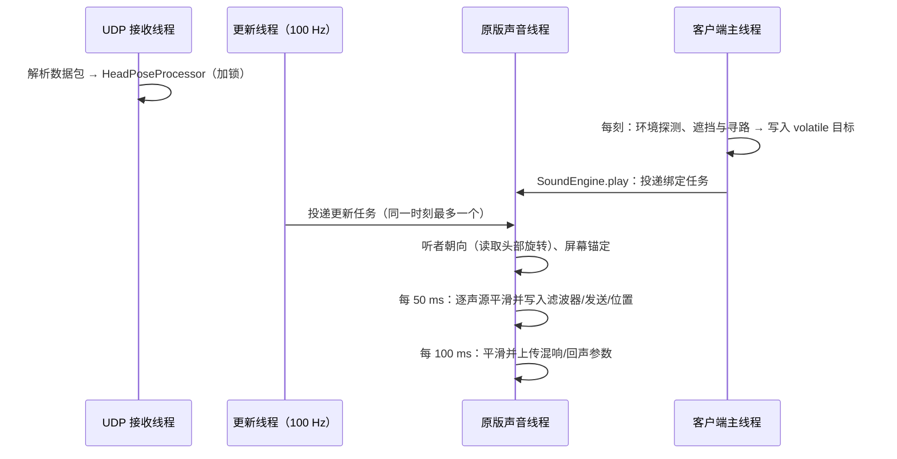

# 架构与源码导读

## 目录结构

```text
SpatialAudio/
├── build.gradle / gradle.properties     Gradle 构建（Fabric Loom 1.19，Java 25）
├── native/macos/                         AirPods 头部追踪助手
│   ├── build.sh                          编译通用二进制、签名、自检、生成清单
│   └── SpatialAudioHeadTracker/
│       ├── main.swift                    读取 CoreMotion 并发送 SAHT 数据包
│       └── Info.plist                    含 NSMotionUsageDescription
├── src/main/java/io/github/obsidianplusplus/spatialaudio/
│   ├── SpatialAudio.java                 常量与日志
│   ├── config/                           配置数据、读写与校验
│   ├── math/                             四元数、One Euro 滤波
│   ├── headtracking/                     UDP 接收、协议解析、姿态处理、助手启动
│   ├── audio/                            OpenAL 接管：HRTF、EFX、听者、逐声源处理
│   ├── acoustics/                        声学模拟：材质、射线、探测、遮挡、寻路、混响模型
│   ├── client/                           入口、按键、命令、叠加层、设置界面、兼容
│   └── mixin/                            四个 Mixin 注入点
├── src/main/resources/                   fabric.mod.json、Mixin 配置、语言文件、图标
├── src/test/                             单元测试（JUnit 5）
├── src/gametest/                         客户端集成测试（Fabric Client GameTest）
└── wiki/                                 本文档
```

## 模块职责

| 包 | 主要类 | 职责 |
| --- | --- | --- |
| `config` | `SpatialAudioConfig`、`ConfigManager`、`CategorySettings` | 配置字段、默认值、合法性修正、JSON 读写与快照 |
| `math` | `Quat`、`OneEuroFilter` | 头部坐标系四元数运算；旋转版 1€ 滤波器 |
| `headtracking` | `HeadTrackingManager`、`HeadPoseProcessor`、`UdpPoseReceiver`、`SahtProtocol`、`OpenTrackProtocol`、`MacHelperLauncher` | 接收数据、滤波预测回中、生命周期、助手的解压/编译/签名/启动 |
| `audio` | `AudioSystem`、`ListenerController`、`SourceProcessor`、`EfxManager`、`SpatialSource`、`AudioUpdateThread` | OpenAL 上下文属性、扩展探测、EFX 资源、听者朝向合成、逐声源参数、周期更新 |
| `acoustics` | `AcousticsManager`、`OcclusionSolver`、`AirPathFinder`、`EnvironmentProbe`、`ReverbModel`、`BlockAcoustics`、`VoxelRaycaster` | 世界查询、遮挡、绕射寻路、环境探测、混响映射 |
| `client` | `SpatialAudioClient`、`KeyBindings`、`SpatialAudioCommands`、`SpatialAudioHud`、`screen/*`、`compat/*` | 入口与用户界面 |
| `mixin` | 见下表 | 注入原版音频代码 |

`acoustics` 中的算法类（`OcclusionSolver`、`AirPathFinder`、`EnvironmentProbe`、`ReverbModel`、`VoxelRaycaster`）只依赖 `BlockQuery` 接口，不依赖 Minecraft，可以在单元测试中用合成世界验证。

## Mixin 注入点

| Mixin | 目标 | 注入 | 作用 |
| --- | --- | --- | --- |
| `LibraryMixin` | `com.mojang.blaze3d.audio.Library` | `createAttributes` HEAD（可取消） | 替换上下文属性：HRTF、输出模式、辅助发送通道 |
| | | `init` TAIL | 探测扩展、读取 HRTF 状态、初始化 EFX |
| | | `cleanup` HEAD | 上下文销毁前停止一切 OpenAL 调用 |
| `ListenerMixin` | `com.mojang.blaze3d.audio.Listener` | `setTransform` 中的 `alListenerfv` / `alListener3f`（WrapOperation） | 写入合成头部旋转后的朝向；记录位置与速度 |
| `ChannelMixin` | `com.mojang.blaze3d.audio.Channel` | 构造 TAIL | 创建附着的 `SpatialSource` |
| | | `setSelfPosition` 中的 `alSourcefv`（WrapOperation） | 记录真实位置，写入重定向或锚定后的位置 |
| | | `setRelative` / `linearAttenuation` / `disableAttenuation` TAIL | 镜像原版参数 |
| | | `attachStaticBuffer` / `attachBufferStream` HEAD | 记录声道数与是否流式 |
| | | `play` HEAD | 登记声源并一次性写入全部空间参数 |
| | | `destroy` HEAD | 从注册表移除 |
| `SoundEngineMixin` | `net.minecraft.client.sounds.SoundEngine` | `play` 中第一次 `ChannelHandle.execute` 之后 | 计算初始遮挡，投递绑定任务（类别、ID、目标） |
| | | `loadLibrary` TAIL | 取得原版声音线程执行器 |

所有注入均设置 `defaultRequire = 1`：若将来的 Minecraft 版本改动了这些方法，游戏会在启动时明确报错，而不是悄悄失效。

## 线程模型



| 线程 | 做什么 | 不做什么 |
| --- | --- | --- |
| 客户端主线程 | 读取世界方块、计算声学目标、处理按键与界面 | 不调用 OpenAL |
| 原版声音线程 | **全部** OpenAL 调用（包括本模组的） | 不读取世界 |
| 更新线程 | 按频率向声音线程投递任务 | 不直接调用 OpenAL |
| UDP 接收线程 | 解析数据包、更新姿态处理器 | 不调用 OpenAL |
| 助手启动线程 | 解压、编译、签名、`open` | |

把所有 OpenAL 调用都放在原版声音线程中执行，有两个好处：

1. 与原版对声源的创建、播放、销毁严格串行，不会出现“声源已被删除仍在设置参数”的错误；
2. 本模组产生的 OpenAL 错误标志会在批次结束时清除，不会被原版的错误检查误报。

上下文销毁（重新加载声音引擎、切换设备）时，`LibraryMixin` 在 `cleanup` 开头加锁并标记失效，更新任务以 `tryLock` 进入，二者不会交叉。

## 一个声音的生命周期

1. **主线程** `SoundEngine.play` 创建声道句柄，原版投递“设置音高/音量/衰减/位置/相对”任务；
2. `SoundEngineMixin` 紧接着在主线程计算初始遮挡（直达 + 绕射），投递“绑定”任务；
3. 原版异步加载缓冲区，投递“挂接缓冲区 + 播放”任务；
4. **声音线程**依次执行：原版设置参数（`ChannelMixin` 记录相对、衰减、位置）→ 绑定 → 挂接缓冲区（记录声道数）→ `play` 前 `SourceProcessor.onPlay` 写入立体声定位、滤波器、发送、空气吸收、感知位置；
5. 播放期间：主线程每 3~6 刻刷新遮挡目标；声音线程每 50 ms 平滑写入；可刻更新声音的位置变化经 `setSelfPosition` 包装后写入；
6. 播放结束，原版释放声道，`destroy` 前从注册表移除。

## 配置变更的传播

| 变更 | 处理 |
| --- | --- |
| 头部追踪参数（强度、滤波、预测、轴向……） | `HeadTrackingManager.applySettings`，立即生效 |
| 数据源、端口、监听范围 | 重启 UDP 接收器与助手 |
| HRTF 模式、数据集、总开关 | `SoundManager.reload()` 重建 OpenAL 上下文 |
| 声学与类别参数 | 声音线程每次更新时读取最新配置，平滑过渡 |
| 方块材质覆盖 | 材质缓存检测到配置对象变化后自动清空 |
