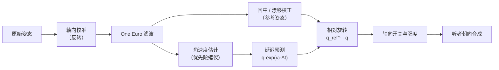

# 头部追踪原理

头部追踪让声音在你转头时保持在世界中的正确位置。本页说明数据从耳机到 OpenAL 听者的完整处理过程，以及在 Apple 渲染方式下头部姿态如何交给 Apple 的空间音频引擎。

## 数据来源

| 来源 | 说明 |
| --- | --- |
| AirPods / Beats（macOS） | 由 [头部追踪助手](macOS-AirPods.md#头部追踪助手) 通过 CoreMotion `CMHeadphoneMotionManager` 读取，包含姿态四元数、陀螺仪角速度与传感器时间戳 |
| OpenTrack | 任意 OpenTrack 兼容追踪器的“UDP over network”输出：偏航、俯仰、横滚（角度）与 XYZ 平移（厘米），见 [OpenTrack 与其它追踪器](OpenTrack.md) |

两者共用一个 UDP 接收器（默认端口 4242，只监听本机回环地址），按数据包长度与魔数自动区分。同时收到两种数据时，AirPods 优先。

## 坐标系约定

模组内部统一使用 Apple 为 AirPods 定义的 **头部坐标系**：

- x 轴指向右耳，y 轴指向正前方（鼻尖），z 轴指向头顶，为右手坐标系；
- **偏航（yaw）** 绕 z 轴，**向左转头为正**；
- **俯仰（pitch）** 绕 x 轴，**抬头为正**；
- **横滚（roll）** 绕 y 轴，**向右歪头（右耳向下）为正**；
- 欧拉角按 Z-X-Y 顺序组合：`q = Rz(yaw) · Rx(pitch) · Ry(roll)`。

OpenTrack 约定向右转头偏航为正，接收时会对偏航取反。若某个追踪器的方向与预期相反，可在设置中逐轴“反转”。

## 处理管线



### 1. One Euro 自适应滤波

传感器数据带有微小抖动，直接使用会让静止时的声场轻微颤动；而普通低通滤波会让转头变得“拖泥带水”。模组采用 Casiez 等人在 CHI 2012 提出的 **1€ 滤波器**，并推广到旋转：

- 截止频率随角速度自适应：`fc = fc_min + β·|ω|`；
- 平滑系数 `α = 1 / (1 + τ/Δt)`，其中 `τ = 1/(2π·fc)`；
- 用球面线性插值（slerp）代替线性插值：`q̂ₖ = slerp(q̂ₖ₋₁, qₖ, α)`。

静止时截止频率低（默认 1.2 Hz），抖动被滤除；快速转头时截止频率升高（β 默认 0.35），延迟很小。

### 2. 延迟预测

从头部转动到耳朵听到变化之间有多段延迟：传感器采样、蓝牙传输、OpenAL 混音缓冲、蓝牙音频回传（AirPods 约 150~250 ms）。模组用头部角速度 ω（AirPods 直接提供陀螺仪读数，OpenTrack 则由相邻帧差分估计）把姿态向前外推：

```text
q(t + Δ) = q(t) ⊗ exp(ω · Δ)
Δ = 预测时长（默认 35 ms）+ 距最近一帧的时间，上限 150 ms
```

预测能明显减少转头时声场“跟不上”的感觉；设得过大则在急停时出现过冲。

### 3. 回中

追踪器的参考系是任意的（AirPods 以开始读取时的方向为基准，并会漂移）。模组记录一个“参考姿态” q_ref，表示“正对屏幕”时的头部姿态，输出相对旋转 `q_rel = q_ref⁻¹ ⊗ q`。

| 回中方式 | 参考姿态 | 适用 |
| --- | --- | --- |
| 完全回中（默认） | 回中瞬间的完整姿态 | 笔记本略低头、侧坐等非标准坐姿 |
| 仅偏航 | 只取回中瞬间的偏航，俯仰与横滚以重力为基准 | 坐姿端正的台式机 |

首次收到数据、或间隔超过 2 秒后重新收到数据（例如重新戴上耳机）时自动回中；也可随时按 `F6`。

### 4. 漂移校正

AirPods 没有磁力计，偏航会随时间缓慢漂移。漂移校正的条件与做法：

- 头部相对偏航小于 25°，且角速度低于 0.2 rad/s，持续 1 秒以上（即“基本正对屏幕且静止”）；
- 每帧把参考姿态绕竖直轴转动 `yaw × Δt / τ`，τ 为“漂移校正时间常数”（默认 25 秒）。

有意的大角度转头（超过 25°）或快速运动都不会触发校正。

### 5. 追踪中断

超过 0.5 秒没有新数据即视为中断，输出以 0.35 秒的时间常数平滑回到正前方，避免摘下耳机时声场突然跳变。

### 6. 轴向开关与强度

可单独关闭偏航、俯仰或横滚的追踪；“追踪强度”按比例缩放三个角度（例如 50% 表示转头 60° 时声场只转 30°）。

## 听者朝向合成

把相对旋转作用到摄像机朝向上，得到最终的 OpenAL 听者朝向，详见 [空间音频与 HRTF](Spatial-Audio-HRTF.md#听者朝向合成)。头部平移（仅 OpenTrack 6DoF）可选地叠加到听者位置上，实现小幅的“运动视差”。以上只适用于模组内置渲染方式，其它方式见下一节。

## 不同渲染方式下的头部姿态

上面的处理管线在三种 [渲染方式](Apple-Spatial-Audio.md) 下完全相同，区别在于结果交给谁：

| 渲染方式 | 头部姿态的去向 |
| --- | --- |
| 模组内置 | 作用于 OpenAL 听者朝向（见上一节） |
| Apple 空间音频 | OpenAL 听者只跟随摄像机。音频桥的泵线程约每 10 ms（约 100 Hz）读取一次同样的头部相对屏幕旋转，作为 [SAAB 的 HEAD 消息](SAAB-Protocol.md#head20-字节) 发给助手，助手把它换算为 `AVAudioEnvironmentNode` 的听者朝向，旋转整个声场 |
| Apple 系统空间化立体声 | 本模组停止自己的头部追踪：数据源视为“关闭”，不启动 UDP 接收器与助手，OpenAL 听者只跟随摄像机。头部追踪由 macOS 完成 |

Apple 空间音频方式下：

- HEAD 消息与音频数据分开发送，不经过助手的音频缓冲，“Apple 缓冲时长”只影响声音事件的延迟，不影响转头的响应；
- `F6` 回中、反转、轴向开关、追踪强度、预测与平滑照常有效，姿态来源可以是 AirPods，也可以是 [OpenTrack](OpenTrack.md)；
- HEAD 只包含旋转，头部平移不会交给助手，OpenAL 听者也不叠加平移；
- 助手具备 `com.apple.developer.coremotion.head-pose` 授权、系统为 macOS 15 或更新、并开启了“Apple 自动头部追踪”时，助手改用 Apple 自动头部追踪（`isListenerHeadTrackingEnabled`）直接读取 AirPods 姿态，并忽略 HEAD 消息，本模组的处理管线与 `F6` 不再作用于声音。随附的助手没有这项授权，始终使用本模组的姿态（见 [头部追踪的两种来源](Apple-Spatial-Audio.md#头部追踪的两种来源)）。

正在渲染时，状态面板“渲染方式”一行会显示当前的来源：“模组头部姿态”或“Apple 自动头部追踪”。

## 调试与校准

打开调试叠加层（设置 → 界面，或 `/spatialaudio hud`），第三行“头部姿态”显示实时姿态角（Apple 空间音频方式下为交给助手的姿态；Apple 系统空间化立体声方式下本模组不追踪，始终为 0）：

- 向左转头，偏航应变为正值；
- 抬头，俯仰应变为正值；
- 向右歪头，横滚应变为正值。

若方向相反，开启对应轴的“反转”；若静止时数值缓慢变化，说明存在漂移，按 `F6` 回中或缩短漂移校正时间常数。
