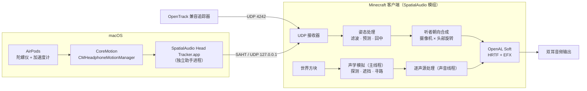

# SpatialAudio Wiki

欢迎来到 SpatialAudio 的文档。SpatialAudio 是一个面向 **Minecraft Java 版 26.3** 的纯客户端 Fabric 模组，为游戏带来 AirPods 空间音频与头部追踪，并以射线追踪的方式模拟真实声学环境。

## 从这里开始

- **[安装与快速上手](Quick-Start.md)**：安装模组、首次使用、确认功能是否生效。
- **[macOS 与 AirPods 设置](macOS-AirPods.md)**：系统空间音频设置、“运动与健身”权限、头部追踪助手。
- **[常见问题与排障](Troubleshooting.md)**：遇到问题先看这里。

## 原理与技术

- **[空间音频与 HRTF](Spatial-Audio-HRTF.md)**：双耳渲染、OpenAL Soft 扩展、屏幕锚定、立体声定位。
- **[Apple 空间音频渲染](Apple-Spatial-Audio.md)**：三种渲染方式；把双耳渲染与头部追踪交给 Apple 空间音频引擎或 macOS 系统空间化立体声。
- **[头部追踪原理](Head-Tracking.md)**：坐标系、回中、One Euro 滤波、延迟预测、漂移校正。
- **[声学模拟](Acoustics.md)**：Eyring 混响、遮挡、A* 绕射寻路、回声、空气吸收、介质滤波、多普勒。
- **[声音类别适配](Sound-Categories.md)**：音乐、唱片、天气、方块、生物、玩家、环境、语音、界面的处理方式。

## 参考

- **[配置参考](Configuration.md)**：全部配置项、默认值与取值范围。
- **[OpenTrack 与其它追踪器](OpenTrack.md)**：接入任意 OpenTrack 兼容的头部追踪设备。
- **[SAHT 协议](SAHT-Protocol.md)**：AirPods 助手与模组之间的 UDP 数据格式。
- **[SAAB 协议](SAAB-Protocol.md)**：Apple 空间音频方式下模组与助手之间的 TCP 数据格式。
- **[兼容性](Compatibility.md)**：与其它模组、操作系统与耳机的兼容情况。

## 开发

- **[架构与源码导读](Architecture.md)**：模块划分、线程模型、Mixin 注入点、数据流。
- **[构建与测试](Building-and-Testing.md)**：从源码构建、单元测试、客户端集成测试、CI。
- **[相关项目与参考文献](References.md)**：调研过的同类项目、论文与技术资料。

## 一图看懂

上图是默认的“模组内置”渲染方式。选择“Apple 空间音频”时，OpenAL 输出的是以摄像机为参照的多声道声场，由助手交给 Apple 的空间音频引擎完成双耳渲染与头部旋转，数据流见 [Apple 空间音频渲染](Apple-Spatial-Audio.md#工作原理)。
